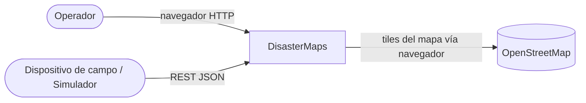
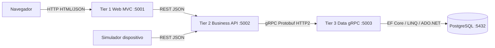
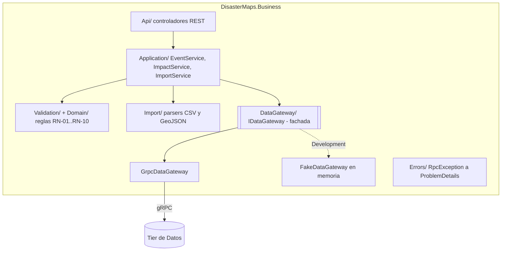
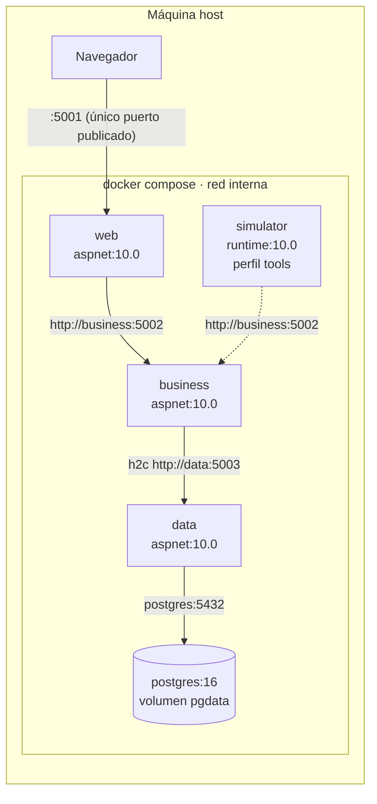
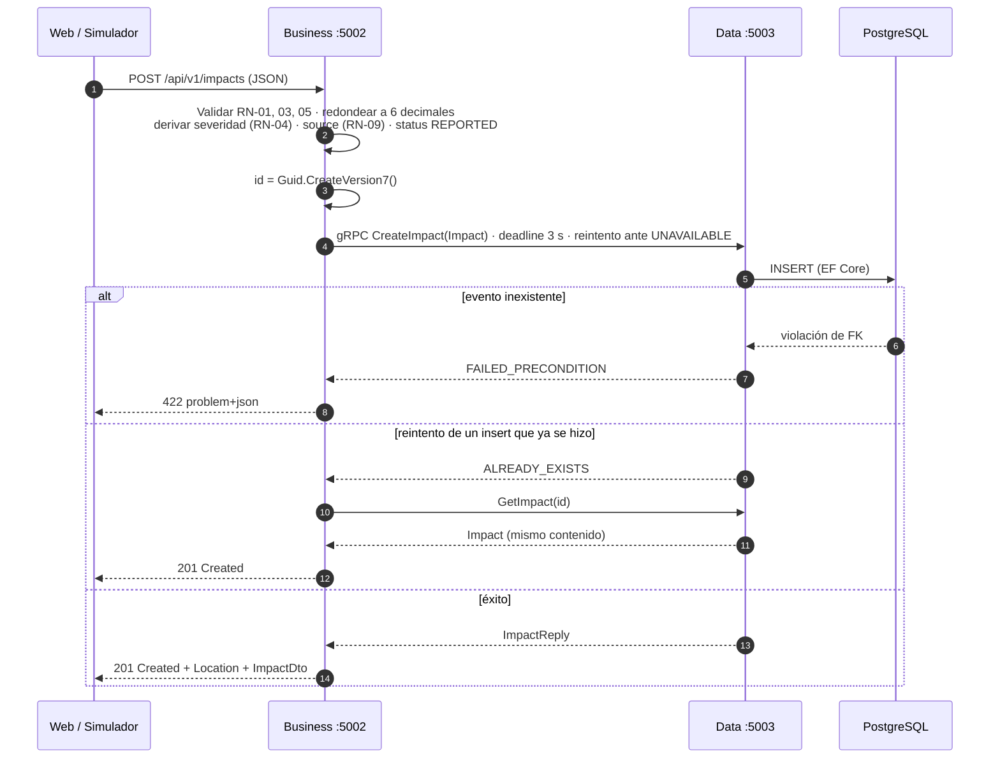
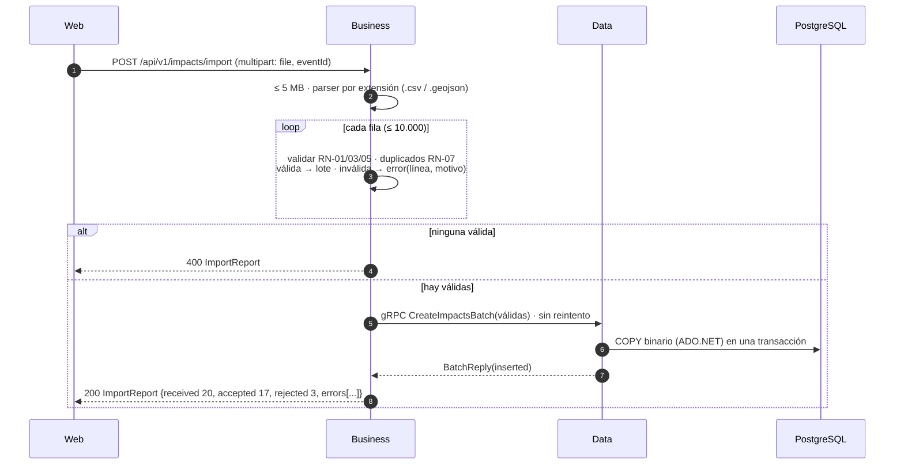
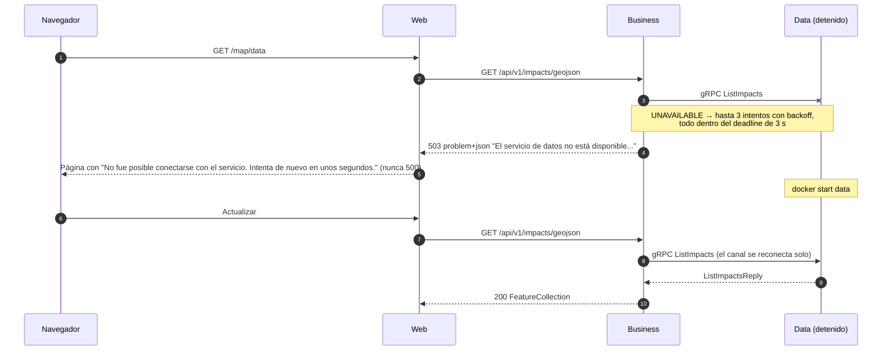

# DisasterMaps — Documento de arquitectura

Taller de Arquitectura de Software (PUJ, 2026-30). Implementación en **.NET 10 (antes .NET Core)**; las lecturas de Jakarta EE son la base conceptual (sección 6).

## 1. Propósito y alcance

> **TALLER.** Con base en las lecturas, implementar una aplicación que permita gestionar los datos de mapas de desastres. Se debe leer o recibir coordenadas de afectaciones y trazar o al menos ubicar las coordenadas en un mapa.

| Requisito derivado | Cómo se cumple |
|---|---|
| **Gestionar** datos de mapas de desastres | CRUD de eventos y afectaciones (`/api/v1/events`, `/api/v1/impacts`) |
| **Leer** coordenadas | Importación de archivos CSV y GeoJSON (`POST /api/v1/impacts/import`) |
| **Recibir** coordenadas | `POST /api/v1/impacts` desde el formulario o desde un dispositivo (simulador) |
| **Trazar / ubicar** en un mapa | Mapa Leaflet + OpenStreetMap con marcadores por severidad, filtros y popups |

Temas del tablero evidenciados: **ADO.NET, LINQ y Entity Framework** (tier de Datos, sección 3.4) y una arquitectura **3-tier distribuida** con **REST** y **gRPC** (secciones 3 y 5).

## 2. Vista de contexto



| Actor / sistema | Interacción |
|---|---|
| Operador | Consulta el mapa, registra afectaciones (clic en el mapa), importa archivos, cambia estados, ve el resumen por municipio |
| Dispositivo / simulador | Envía afectaciones por REST con `source = DEVICE` |
| OpenStreetMap | Sistema externo: provee las teselas del mapa (sin API key, con atribución) |

## 3. Vistas de componentes y despliegue

### 3.1 Vista C&C: tres capas físicas cerradas

Cada tier es un proceso independiente y **solo habla con el tier adyacente**: la Web nunca llama a Datos y el navegador nunca llama a Negocio.



| Tier | Proyecto | Expone | Consume |
|---|---|---|---|
| 1 Presentación | `DisasterMaps.Web` (ASP.NET Core MVC + Leaflet) | HTML + `/map/data` (GeoJSON) | REST de Business |
| 2 Negocio | `DisasterMaps.Business` (ASP.NET Core Web API) | REST `/api/v1` | gRPC de Data |
| 3 Datos | `DisasterMaps.Data` (ASP.NET Core gRPC) | gRPC `DisasterData` | PostgreSQL |
| EIS | PostgreSQL 16 | SQL | — |

### 3.2 Tier de Negocio (estructura interna)



- **Fachada `IDataGateway`:** los servicios nunca usan el cliente gRPC; la fachada trabaja con DTOs y solo `GrpcDataGateway` conoce los mensajes del `.proto`. Con `DataTier:UseFake=true` se inyecta `FakeDataGateway`, que imita el contrato y sus errores. Así Business se desarrolló y probó en paralelo con Data.
- **Servicios sin estado** registrados como *scoped* en el contenedor de inyección de dependencias (equivalente a un `@Stateless`).
- **Reglas de negocio** RN-01..RN-10 en `Domain/` y `Validation/`; los umbrales de severidad se leen con `IOptionsMonitor` (se cambian en `appsettings` sin recompilar).
- **Errores:** `IExceptionHandler` global → `application/problem+json` en español; la validación responde `ValidationProblemDetails` con `errors` por campo.

### 3.3 Vista de despliegue



| Contenedor | Imagen | Puerto | Healthcheck | Depende de (sano) |
|---|---|---|---|---|
| `postgres` | `postgres:16` | 5432 (interno) | `pg_isready` | — |
| `data` | build multi-stage | 5003 h2c (interno) | conexión TCP | `postgres` |
| `business` | build multi-stage | 5002 (interno; publicado solo en modo dev) | `GET /alive` | `data` |
| `web` | build multi-stage | **5001 publicado** | conexión TCP | `business` |
| `simulator` | build multi-stage | — | — | `business` (perfil `tools`) |

Las direcciones de los servicios y la cadena de conexión se inyectan por variables de entorno (`DataTier__Address`, `Business__BaseUrl`, `ConnectionStrings__DisasterMaps`).

### 3.4 Tier de Datos

> _Sección a cargo de Rol 2 (Andrés): modelo (ER), CHECK e índices, dónde se usa EF Core / LINQ / ADO.NET y por qué, y el SQL generado por las consultas LINQ._

### 3.5 Tier de Presentación

> _Sección a cargo de Rol 2 (Andrés): pantallas, cómo obtiene el mapa los datos sin llamar a Business desde el navegador, y manejo de errores._

## 4. Diagramas de secuencia

### 4.1 Recibir una afectación por REST hasta la BD



### 4.2 Importar un archivo con filas inválidas



### 4.3 Data caído → 503 → mensaje amigable



## 5. Decisiones de arquitectura

| ID | Driver | Alternativas | Decisión y trade-off |
|---|---|---|---|
| **D-01** Capas físicas cerradas | Enunciado (3-tier distribuida); separación de responsabilidades | (a) monolito en capas lógicas; (b) 3 procesos con acceso solo al adyacente | (b). **Mejora** modificabilidad, despliegue independiente y aislamiento (el navegador no ve Business ni Data). **Degrada** latencia (2 saltos de red) y complejidad operativa (4 contenedores). |
| **D-02** REST arriba, gRPC abajo | Interoperabilidad hacia clientes; eficiencia interna | (a) REST en ambos; (b) gRPC en ambos; (c) REST Web→Business y gRPC Business→Data | (c). REST es legible, documentable con OpenAPI y consumible por cualquier cliente (gRPC no corre en el navegador sin gRPC-Web). gRPC da un contrato fuerte generado desde `.proto` y binario sobre HTTP/2 para lotes grandes. **Costo:** dos tecnologías y dos contratos; depurar gRPC exige grpcurl/Postman. |
| **D-03** Tres tecnologías de acceso a datos | Enunciado (ADO.NET, LINQ, EF) y rendimiento | Una sola tecnología vs cada una donde aporta | EF Core para el CRUD, LINQ sobre `IQueryable` para filtros y agregados, ADO.NET (COPY) para la importación masiva. **Costo:** el lote ADO.NET se salta las validaciones de EF → la validación vive en Business y las CHECK de la BD son la última barrera. |
| **D-04** Ids generados en Business (UUID v7) | Confiabilidad: reintentos seguros | (a) id autogenerado por la BD; (b) id del cliente | (b). Hace `CreateImpact` **idempotente**: un reintento tras un fallo de red no duplica la afectación (ALREADY_EXISTS → se resuelve con `GetImpact`). UUID v7 es ordenable por tiempo, lo que favorece al índice. **Costo:** ids de 16 bytes. |
| **D-05** Deadline y reintentos gRPC | Disponibilidad: degradar rápido | Sin límites vs deadline + retry selectivo | Deadline de 3 s por llamada; reintento (3 intentos, backoff 0,2→1 s) **solo** en lecturas y `CreateImpact`, ante UNAVAILABLE. Lote, update y delete no se reintentan (no son idempotentes). Garantiza el 503 en ≤ 3,5 s. |
| **D-06** Fachada `IDataGateway` + fake | Modificabilidad y trabajo en paralelo | Usar el cliente gRPC directo | Fachada con dos implementaciones (gRPC / en memoria). Permitió desarrollar y probar Business sin Data. **Costo:** una capa de mapeo más. |
| **D-07** Leaflet + OpenStreetMap | Sin costo ni API key; enunciado pide ubicar en mapa | Google Maps, Mapbox, OpenLayers | Leaflet 1.9 por CDN + tiles OSM con atribución. Ligero y suficiente para puntos. **Costo:** dependencia de un servicio externo de tiles. |
| **D-08** Errores RFC 7807 en español | Usabilidad e interoperabilidad | Formato propio | `ProblemDetails` / `ValidationProblemDetails` con `errors` por campo y `traceId` para correlacionar con los logs. |

El detalle de las decisiones menores está en `docs/DECISIONS.md` (R1-xx, R2-xx).

## 6. Equivalencias con las lecturas (Jakarta EE → .NET)

| Concepto de las lecturas | En esta solución | Lectura de referencia |
|---|---|---|
| Multitier distribuido JEE (client / web / business / EIS tier) | Web :5001 / Business :5002 / Data :5003 / PostgreSQL | Clase 1 Intro Jakarta EE; Goncalves cap. 1 |
| Ejercicio B de EJB: negocio y datos en dos WildFly (8080 / 8090) | Business y Data como dos procesos (5002 / 5003) | Clase 3 EJB |
| EJB `@Remote` + RMI-IIOP, clientes remotos | servicio gRPC definido en `.proto` | Clase 3 EJB; Wetherbee caps. 2 y 12 |
| EJB `@Stateless` | servicios de aplicación sin estado registrados en el contenedor DI (scoped) | Wetherbee cap. 2; Goncalves cap. 7; Späth cap. 7 |
| Fachada de bajo acoplamiento negocio↔datos | `IDataGateway` en Business (fachada del cliente gRPC) | Clase 3 EJB |
| CDI / JNDI lookup | inyección de dependencias + `appsettings` (direcciones de servicios) | Goncalves cap. 2; Wetherbee cap. 10 |
| JPA `EntityManager` / contexto de persistencia | EF Core `DbContext` / change tracker | Clase 2 JPA; Jungmann cap. 6 |
| `@Entity` POJO con `@Id`, `@OneToMany` | entidad POCO + Fluent API (`DisasterEvent` 1—N `Impact`) | Jungmann caps. 4–5; Goncalves cap. 5 |
| JPQL / Criteria API (consultas dinámicas) | LINQ con `IQueryable` componible | Jungmann caps. 7–9 |
| JDBC | ADO.NET (Npgsql) | Jungmann cap. 1 |
| Transacciones JTA | transacción explícita en el lote ADO.NET / `SaveChanges` | Späth cap. 10; Goncalves cap. 9 |
| Bean Validation | validadores en Business + data annotations en la Web | Goncalves cap. 3; Bauke cap. 5 |
| JAX-RS / Jakarta REST + JSON | ASP.NET Core Web API | Späth cap. 5; Goncalves cap. 15 |
| JSF/Faces: FacesServlet, backing beans, Facelets (MVC) | ASP.NET Core MVC: routing, controllers, vistas Razor (+ layout) | Clase 5 JSF; Bauke caps. 7–8; especificación Faces 4.1 |
| JMS (cola punto-a-punto) / Message-Driven Beans | no se usa; extensión diferida para ingesta asíncrona (sección 8) | Clase 3a JMS; Wetherbee cap. 5 |

## 7. Metas de verificación

| Atributo | Estímulo / entorno | Medida objetivo | Resultado medido |
|---|---|---|---|
| Rendimiento (mapa) | 2.000 afectaciones en BD, compose local | `GET /impacts/geojson` < 1 s; el mapa las pinta en < 2 s | _pendiente (Fase 2, con Data real)_ |
| Rendimiento (importación) | CSV de 1.000 filas válidas | end-to-end < 3 s | _pendiente (Fase 2)_. Con el fake: 20 filas procesadas en Business en 15 ms |
| Disponibilidad / degradación | contenedor Data detenido | Business responde 503 en ≤ 3,5 s; la Web muestra un mensaje amigable; se recupera sin reiniciar | Prueba automática `DataTierDownTests`: **503 en ~3 s** con el cliente gRPC real contra un puerto cerrado. Recuperación en compose: _pendiente_ |
| Modificabilidad | cambiar los umbrales de severidad | solo `appsettings`, sin recompilar | **Cumple:** `SeverityPolicy` lee `IOptionsMonitor<SeverityThresholds>` (prueba `Uses_current_thresholds_when_configuration_changes`) |

Cómo medir: ver la sección "Medir las metas" del `README.md`.

## 8. Diferidos (fuera de alcance, con justificación)

- **Seguridad (autenticación y autorización):** el enunciado no la pide. Mitigación mínima: solo la Web publica puerto; Business y Data quedan en la red interna de Docker.
- **PostGIS / consultas espaciales:** lat/lon como `double` + índice compuesto bastan para filtrar por bbox con el volumen del taller (miles de puntos).
- **Mensajería asíncrona (estilo JMS / RabbitMQ)** para dispositivos de campo: la ingesta es síncrona por REST; una cola desacoplaría los picos de reportes y es la extensión natural (equivalente a un Message-Driven Bean).
- **Polígonos de zonas afectadas:** solo puntos; usar GeoJSON deja la puerta abierta.

## 9. Cómo ejecutar

```bash
# Todo con Docker (modo demo): abre http://localhost:5001
docker compose up --build

# Simulador de dispositivo (en otra terminal)
docker compose --profile tools run --rm simulator --event-id <uuid> --count 20 --interval 2

# Modo dev: además Business en http://localhost:5002/scalar/v1 y Postgres en 5432
docker compose -f docker-compose.yml -f docker-compose.dev.yml up --build

# Pruebas
dotnet test DisasterMaps.sln
```

Más detalle (ejecución de cada tier por separado y guion de demo) en el `README.md`.
