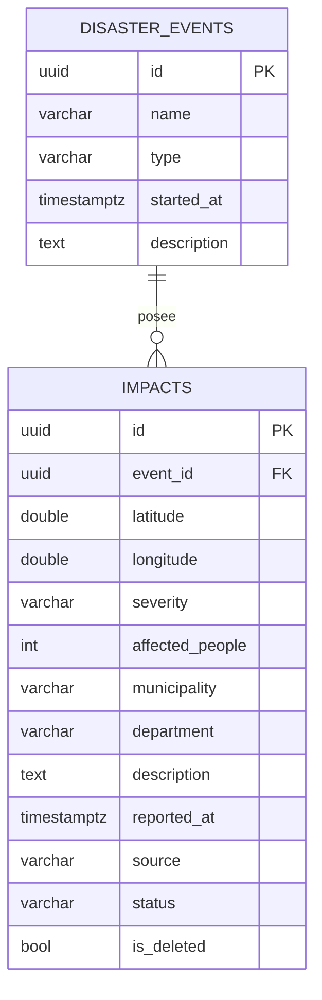

# Aportes de Rol 2 — integración en ARQUITECTURA.md (secciones 3.4 y 3.5)

## 3.4 Tier de Datos

El proceso independiente `DisasterMaps.Data` expone `DisasterData` (los nueve RPC del contrato congelado) por gRPC sobre HTTP/2 sin TLS (`h2c`, puerto 5003) y accede exclusivamente a PostgreSQL 16. En ASP.NET Core se inyecta un mismo `NpgsqlDataSource` para los contextos de EF Core y las operaciones ADO.NET. Los identificadores UUID son asignados por Business.



**Protección de datos:** `CHECK latitude BETWEEN -90 AND 90`, `CHECK longitude BETWEEN -180 AND 180`, `CHECK NOT(latitude=0 AND longitude=0)`, `CHECK affected_people>=0`, dominio de severidad (`LOW`, `MEDIUM`, `HIGH`, `CRITICAL`) y de estado; FK `impacts.event_id → disaster_events.id`. Índices `event_id`, `(latitude,longitude)` y `reported_at`. `IsDeleted` aplica el filtro global de EF para que los registros borrados lógicamente no aparezcan. Timestamps `timestamptz` en UTC. Migración `InitialCreate` y semilla de 40 puntos sintéticos en Development (no son datos oficiales).

**Tres accesos a datos:** EF Core (`DbContext`, `SaveChangesAsync`) administra altas, consultas por ID, modificaciones y soft delete; LINQ compone filtros tipados sobre `IQueryable` con `AsNoTracking`, `Where`, `OrderBy`, `Skip/Take`, `CountAsync` y `GroupBy/Count/Sum/Max` para informes; ADO.NET (`NpgsqlBinaryImporter`, PostgreSQL `COPY ... FORMAT BINARY` dentro de una transacción) gestiona importaciones masivas atómicas sin change tracking. Las validaciones primarias están en Business y las restricciones SQL son la última defensa.

Consultas SQL **representativas** de las expresiones LINQ; el SQL exacto debe capturarse con `ToQueryString()` en la ejecución local (no se declara medido todavía):

```sql
-- ListImpacts: EF agrega WHERE según filtros activos y paginación.
SELECT i.* FROM impacts AS i
WHERE NOT i.is_deleted AND i.latitude >= @min_lat AND i.latitude <= @max_lat
  AND i.longitude >= @min_lon AND i.longitude <= @max_lon
ORDER BY i.reported_at DESC, i.id
LIMIT @page_size OFFSET @offset;
-- SummaryByMunicipality: evaluación del agrupamiento en PostgreSQL.
SELECT municipality, department, COUNT(*) AS impacts,
       SUM(affected_people) AS affected_people,
       MAX(CASE severity WHEN 'CRITICAL' THEN 4 WHEN 'HIGH' THEN 3
           WHEN 'MEDIUM' THEN 2 ELSE 1 END) AS max_severity_rank
FROM impacts WHERE NOT is_deleted
GROUP BY municipality, department;
```

**Errores gRPC:** `ALREADY_EXISTS` para UUID duplicado (idempotencia de reintentos), `FAILED_PRECONDITION` por evento inexistente, `NOT_FOUND` para ID inexistente o soft-deleted; `INVALID_ARGUMENT` por CHECK o validación; `UNAVAILABLE` si falla PostgreSQL; `INTERNAL` sin exponer stack. El health check gRPC `grpc.health.v1` incorpora conectividad a PostgreSQL.

## 3.5 Tier de Presentación

`DisasterMaps.Web` es un proceso independiente ASP.NET Core MVC con vistas Razor en español (puerto 5001); representa el tier Web/JSF de las lecturas. Incluye seis pantallas: mapa de afectaciones, lista paginada de afectaciones (edición de estado y borrado lógico), registro manual con coordenadas desde clic en mapa, importación CSV/GeoJSON con reporte, gestión de eventos y resumen por municipio. Los formularios usan validaciones del lado servidor y muestran `errors` por campo que retorna Business.

El flujo del mapa conserva el cierre entre tiers: **navegador → `GET /map/data` de Web → `GET /api/v1/impacts/geojson` de Business → gRPC Data → PostgreSQL**. El navegador no accede directamente a Business ni a Data. Leaflet 1.9 usa teselas OpenStreetMap con atribución y `L.geoJSON`, respetando el orden GeoJSON `[longitud,latitud]`; marcadores por severidad con leyenda textual, filtros, popups, actualización cada 15 s y clustering sobre 500 puntos. El cliente HTTP tipado usa `Business:BaseUrl` inyectado por configuración y timeout de 5 s; existe cliente simulado para trabajo en paralelo.

Los fallos REST y las desconexiones se muestran con el aviso «No fue posible conectarse con el servicio. Intenta de nuevo en unos segundos.» sin generar una página 500. La importación maneja el caso de `400 ImportReport` (todas las filas rechazadas). En la edición, solo se ofrece la transición permitida `REPORTED → VERIFIED → ATTENDED`.

> **Evidencias pendientes antes de afirmar cumplimiento de metas:** compilar y ejecutar los servicios en compose, importar 17/3, comprobar health, medir SQL emitido y tiempos de 2.000 puntos / 1.000 filas.
